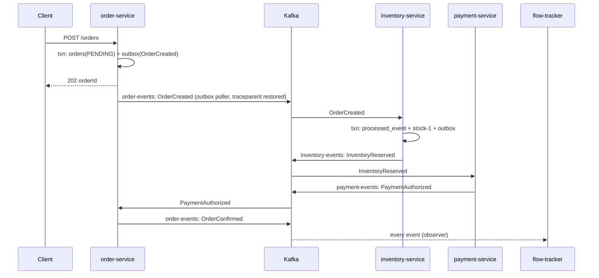
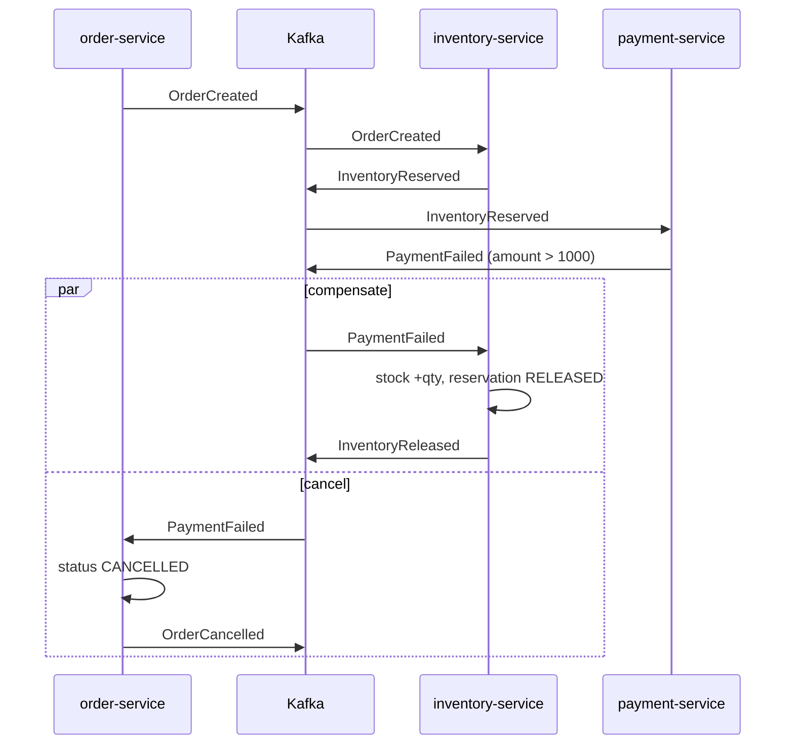

# Choreography saga + distributed tracing demo

Order → inventory → payment, **no orchestrator**. Services react to each other's events over Kafka.
One order = **one connected trace** in Jaeger, plus a per-order timeline from `flow-tracker-service`.

Stack: Java 21, Spring Boot 3.5, Maven multi-module, Postgres (db per service), Flyway, Kafka (KRaft),
OpenTelemetry Java agent → OTel Collector → Jaeger.

| Service | Port | Role |
|---|---|---|
| order-service | 8080 | `POST /orders`, `GET /orders/{id}`; start + end of every flow |
| inventory-service | 8081 | reserves / rejects / releases stock |
| payment-service | 8082 | authorizes or fails payment |
| flow-tracker-service | 8083 | observer: stores every event, `GET /flows/{orderId}`, `GET /flows/stuck` |
| jaeger | 16686 | trace UI |

## a) Start

```bash
docker compose up --build          # first build ~2-3 min (maven + agent download)
# wait until all 4 services answer:
for p in 8080 8081 8082 8083; do curl -s localhost:$p/actuator/health; echo; done
```

Everything at once: `./scripts/run-scenarios.sh` (needs `jq`) places all 4 orders below and prints the flows.
Integration tests (Testcontainers): `mvn verify`.

## b) The 4 scenarios

```bash
# happy: OrderCreated -> InventoryReserved -> PaymentAuthorized -> OrderConfirmed
curl -s -X POST localhost:8080/orders -H 'Content-Type: application/json' -d '{"sku":"SKU-1","qty":1,"amount":100}'

# out of stock: OrderCreated -> InventoryRejected -> OrderRejected
curl -s -X POST localhost:8080/orders -H 'Content-Type: application/json' -d '{"sku":"SKU-2","qty":1,"amount":100}'

# payment fail (amount > 1000): ... PaymentFailed -> OrderCancelled + InventoryReleased (compensation)
curl -s -X POST localhost:8080/orders -H 'Content-Type: application/json' -d '{"sku":"SKU-1","qty":1,"amount":1500}'

# slow payment (amount == 777 -> payment-service sleeps 10s). Check stuck WHILE it sleeps:
curl -s -X POST localhost:8080/orders -H 'Content-Type: application/json' -d '{"sku":"SKU-1","qty":1,"amount":777}'
sleep 4; curl -s 'localhost:8083/flows/stuck?olderThanSeconds=3'
```

Each POST returns `202 {"orderId":"...","status":"PENDING"}`. Seed stock: SKU-1 = 10, SKU-2 = 0.
(Stock is finite: SKU-1 runs out after 10 reservations that are not released. Restart with `docker compose down -v` to reset.)

`/flows/stuck` semantics: first event older than N seconds **and** no terminal event
(`OrderConfirmed`/`OrderRejected`/`OrderCancelled`). The 777 order resolves after 10s, so with the default
`olderThanSeconds=30` it would never be reported; use a smaller threshold to catch it mid-flight.

## c) Jaeger guide (http://localhost:16686)

Service = `order-service`, Find Traces. Top row = `POST /orders`. Open it. Real output (durations trimmed):

**Happy** (one trace, 3 services + tracker; `order-events publish` of the confirm event is the last bar)
```
order-service      POST /orders
 └ create order            (custom: order.id, event.type, event.id)
    ├ INSERT orders / INSERT outbox
    └ order-events publish                         <- poller, parent restored from outbox row
       ├ inventory-service order-events process
       │   └ handle OrderCreated  ── UPDATE stock, INSERT reservation, INSERT outbox
       │      └ inventory-events publish
       │         └ payment-service inventory-events process
       │             └ handle InventoryReserved ── INSERT payment, INSERT outbox
       │                └ payment-events publish
       │                   └ order-service payment-events process
       │                       └ handle PaymentAuthorized ── UPDATE orders, INSERT outbox
       │                          └ order-events publish            (OrderConfirmed)
       └ flow-tracker-service  ... process/handle spans hang off every publish span (siblings of the real consumers)
```

**Out of stock**: same top half, `handle OrderCreated` ends with `InventoryRejected`; no payment-service handler
(its `inventory-events process` is a 0ms "ignored" span). Back in order-service `handle InventoryRejected` → `OrderRejected`.

**Payment fail** (compensation = fan-out, two siblings under `payment-events publish`):
```
payment-events publish
 ├ order-service     handle PaymentFailed      -> UPDATE orders=CANCELLED -> order-events publish (OrderCancelled)
 └ inventory-service handle PaymentFailed      -> SELECT reservation, UPDATE stock (+qty) -> inventory-events publish (InventoryReleased)
```

**Slow payment**: identical to happy except one fat bar:
```
payment-service  handle InventoryReserved  [============================ 10 s ============================]
                  └ payment-gateway slow call (custom span)  [============ 10 s ==============]
```
Everything else is a few ms; the gap is obvious. Meanwhile `/flows/stuck` lists the order with `lastEvent=InventoryReserved`.

Tips: tag search `order.id=<uuid>`; the flow-tracker's `process` spans are noise → filter by service.
Quiet "ignored" spans (a few ms, e.g. order-service reading `InventoryReserved`) exist because every consumer
group sees whole topics; they are counted as `outcome="ignored"`.

## d) Find a flow

```bash
ORDER=<orderId from the POST>
curl -s localhost:8083/flows/$ORDER | jq        # status, traceId, ordered timeline
# -> open http://localhost:16686/trace/<traceId>
docker compose logs --no-log-prefix | grep <traceId>      # every service's JSON log lines for that trace
curl -s localhost:8080/orders/$ORDER              # current order status
```
Log line (JSON, one per business milestone at INFO; everything else DEBUG, set `SAGA_LOG_LEVEL=DEBUG` on a service):
```json
{"message":"event handled type=InventoryReserved","service":"payment-service","trace_id":"3761a6e9...","span_id":"dd1ce65b...","order_id":"41ffcebd-...","level":"INFO"}
```
`trace_id`/`span_id` are MDC entries injected by the OTel agent; `order_id` is set by our code.
Metrics: `curl localhost:8081/actuator/prometheus | grep events_handled` →
`events_handled_total{service,event_type,outcome}` with outcome ∈ `processed | duplicate | ignored | error`.

## e) Sequence diagrams

Happy:


Compensation (payment fails):


## Tracing design

**Propagation.** The agent injects `traceparent` into every Kafka record header on publish and extracts it in the
consumer, so consumer spans join the original `trace_id`. Zero code for that part.

**The outbox breaks the context.** A request/handler thread writes the outbox row; a *different* thread (the poller)
publishes it later. By then there is no current span, so the producer span would start a new trace. Fix
(`Outbox.append` / `OutboxPoller.publish` / `SagaTracing`):
1. `append()` runs inside the handler span (`create order` or `handle <Event>`) and stores
   `SagaTracing.currentTraceParent()` in `outbox.traceparent`, same transaction as the state change.
2. The poller reads the row, `SagaTracing.restore(traceparent)` makes it the current context, then sends. The
   agent's Kafka producer span becomes a child of the writing span and injects a fresh `traceparent` for the consumer.
3. The poll query itself runs under an *unsampled* parent so an idle poller does not create an empty trace per tick.

Result: `POST → create order → publish → process → handle → … publish → process → handle (order-service)` in one trace.

**Span links vs parent-child: parent-child for consumers.** Each message here has exactly one cause and is handled
once, so "child of the publish span" is the truthful relationship and gives one readable waterfall
(and `flow-tracker.trace_id` can be checked against the POST's trace). Links fit when the causal shape is *not* a tree:
batch consumers (one span, many parents), fan-in/join (an aggregate that waits for N events), or fire-and-forget work
that outlives the trace (a scheduled retry). None of that exists in this saga. The fan-*out* (compensation, flow-tracker)
is fine as siblings under one parent. Trade-off accepted: with parent-child a slow consumer lengthens the producer's
subtree, so the trace's total duration includes async lag; that is exactly what we want to see (the 10s payment bar).
If this grew to batch listeners, switch those to links.

**Custom spans** (`SagaTracing.start`): `create order`, `handle <EventType>`, `payment-gateway slow call` with
attributes `order.id`, `event.type`, `event.id` (+ `event.duplicate`).

## f) Choreography vs orchestration: what was harder to see here

| | Orchestration (see sibling `saga-orchestrator-tracing-demo`) | Choreography (this) |
|---|---|---|
| Where is the flow defined? | One state machine in one class | Implicit: spread over 3 services' listeners |
| "What state is order X in?" | `select` from saga table | Nobody knows; reconstruct from events |
| "Which orders are stuck?" | saga timeout scanner | Nobody owns a timeout |
| Adding a step | edit orchestrator | edit one service, but check who else listens |
| Compensation | orchestrator commands undo in order | each service must react to the right failure event itself; fan-out |
| Debug | read one log | correlate N logs across services |

Compensations here:
- **flow-tracker** subscribes to all topics and rebuilds the picture: `GET /flows/{orderId}` (ordered timeline,
  derived status, trace id) and `GET /flows/stuck` (the missing "who owns the timeout" answer, as a read model).
  It is a pure observer: if it dies, the saga still works.
- **Tracing** turns the implicit flow into an explicit waterfall per order, and the same `trace_id` is in every log line.
- **order-service publishes `OrderConfirmed/Rejected/Cancelled`** (small addition to the spec'd topics): gives the flow
  an explicit terminal event so "finished vs stuck" is decidable, and closes the trace loop back at the order.
- Remaining weakness: tracker only *detects* stuck flows; nothing acts on them. A real system needs a timeout owner or alert.

## g) Event catalog (AsyncAPI-style)

Envelope (JSON, all events): `eventId` (uuid, idempotency key), `eventType`, `orderId` (correlation id **and**
Kafka key → per-order ordering), `occurredAt` (ISO-8601), `producer`, `payload`.
Kafka headers: `traceparent` (injected by the OTel agent). Each topic has 3 partitions and a `<topic>.DLT`.

| Topic | Event | Producer | Consumers | Payload |
|---|---|---|---|---|
| order-events | OrderCreated | order-service | inventory-service, flow-tracker | sku, qty, amount |
| order-events | OrderConfirmed* | order-service | flow-tracker | status |
| order-events | OrderRejected* | order-service | flow-tracker | status |
| order-events | OrderCancelled* | order-service | flow-tracker | status |
| inventory-events | InventoryReserved | inventory-service | payment-service, flow-tracker | sku, qty, amount |
| inventory-events | InventoryRejected | inventory-service | order-service, flow-tracker | reason=OUT_OF_STOCK |
| inventory-events | InventoryReleased | inventory-service | flow-tracker | sku, qty |
| payment-events | PaymentAuthorized | payment-service | order-service, flow-tracker | amount |
| payment-events | PaymentFailed | payment-service | order-service, inventory-service, flow-tracker | reason=AMOUNT_LIMIT_EXCEEDED |

\* addition to the original spec, see section f.

Reliability:
- **Publish**: transactional outbox in every producing service (state + event in one txn; poller at-least-once, in order).
- **Consume / idempotency**: `processed_event(event_id PK)` inserted in the *same* txn as the handler's effects.
  Duplicate delivery → insert affects 0 rows → handler skipped → `outcome="duplicate"`. Order updates are also
  guarded (`where status='PENDING'`).
- **Retry + DLT**: handler exceptions retry 3× with exponential backoff (0.5s, 1s, 2s) then go to `<topic>.DLT`.
  Unparseable messages (`IllegalArgumentException`) skip retries. Try it:
  ```bash
  echo 'not-json' | docker compose exec -T kafka /opt/kafka/bin/kafka-console-producer.sh --bootstrap-server localhost:9092 --topic order-events
  docker compose exec -T kafka /opt/kafka/bin/kafka-console-consumer.sh --bootstrap-server localhost:9092 --topic order-events.DLT --from-beginning --timeout-ms 10000
  ```
  (every consuming group fails separately, so one poison message appears once per consumer group of that topic.)

## Layout

```
common/                shared: Event envelope, Outbox + OutboxPoller, EventProcessor (idempotency+span+metric),
                       SagaTracing (OTel API helper), Kafka error handler/DLT, JSON logback, saga-common.yml
order-service/ inventory-service/ payment-service/ flow-tracker-service/   one listener class (+ controller) each
integration-tests/     Testcontainers: happy, payment-fail compensation, out-of-stock, duplicate delivery, slow/stuck
docker/                otel-collector, postgres init (one DB per service)
```
