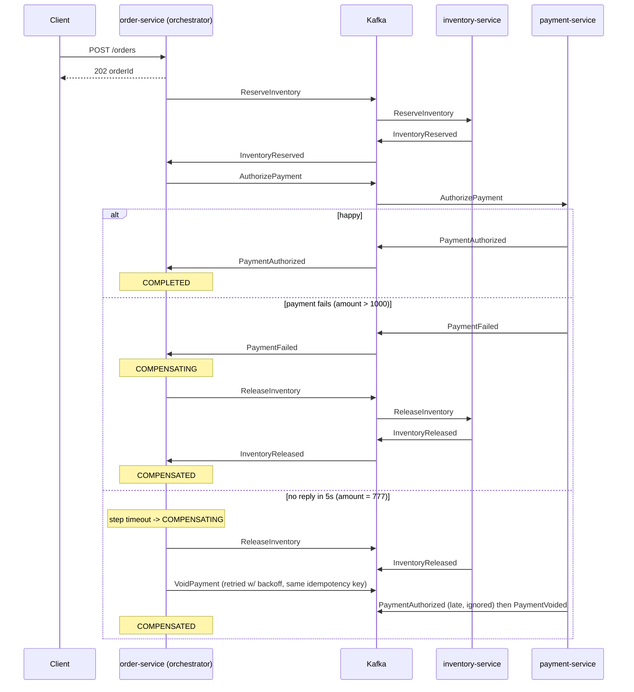

# saga-orchestrator-tracing-demo

Distributed tracing + orchestrated saga across 3 Spring Boot services (Kafka between them).
Place an order, see the whole flow (HTTP -> Kafka -> DB -> Kafka -> ...) as **one trace in Jaeger**, including the compensation path.

Stack: Java 21, Spring Boot 3.5, spring-kafka, Postgres (1 DB/service, Flyway), Kafka KRaft, OTel Java agent -> OTel Collector -> Jaeger.

| Service | Port | Role |
|---|---|---|
| order-service | 8080 | saga orchestrator, `POST /orders`, `GET /orders/{id}` (customer view), `GET /orders/{id}/saga` (debug view) |
| inventory-service | 8081 | Reserve/ReleaseInventory (SKU-1 qty 10, SKU-2 qty 0) |
| payment-service | 8082 | Authorize/VoidPayment (amount>1000 fails, 777 = 10s hang) |

Each has `/actuator/health` and `/actuator/prometheus`.

## a) Start

```bash
docker compose up --build        # first build downloads maven deps + OTel agent; offline after that
```
Ready when `curl -s localhost:8080/actuator/health` returns UP (also 8081, 8082). Jaeger UI: http://localhost:16686

## b) Four scenarios

```bash
order() { curl -s -X POST localhost:8080/orders -H 'Content-Type: application/json' -d "{\"sku\":\"$1\",\"qty\":1,\"amount\":$2}"; echo; }

order SKU-1 100     # 1. happy path           -> COMPLETED
order SKU-2 100     # 2. out of stock         -> COMPENSATED (nothing to undo)
order SKU-1 1500    # 3. payment fails        -> release inventory -> COMPENSATED
order SKU-1 777     # 4. payment gateway hang -> timeout (5s) -> release + void -> COMPENSATED (~12s)
```
Each returns `202 {"orderId":"..."}` immediately. Then:
```bash
curl -s localhost:8080/orders/<orderId> | jq          # customer view: status, reason, message
curl -s localhost:8080/orders/<orderId>/saga | jq     # debug view: state, timeline, traceId
```
Customer view maps internal states: `PENDING` (incl. compensating), `CONFIRMED` (COMPLETED), `FAILED` (COMPENSATED) with a `reason`:
`OUT_OF_STOCK`, `PAYMENT_DECLINED` or `TEMPORARY_ERROR` (timeout). Example:
```json
{"orderId":"...","status":"FAILED","reason":"OUT_OF_STOCK","message":"Sorry, this item is out of stock. You were not charged."}
```
Open `http://localhost:16686/trace/<traceId>` directly, or Jaeger UI -> Service `order-service` -> Find Traces.

## c) What to look for in Jaeger

Every scenario = **1 trace, root `POST /orders`, 3 services**. Spans you see:
agent-made (`POST /orders`, `<topic> publish`, `<topic> process`, `INSERT orders.saga_instance` ...) and custom
(`saga.start`, `saga.reply X`, `saga.transition A->B`, `inventory.handle X`, `payment.handle X`; attrs `order.id`, `saga.state`, `saga.step`, `idempotency.key`).

**1. Happy path** (~40 spans)
```
order      POST /orders
order       └ saga.start
order          └ inventory-commands publish
inventory         └ inventory-commands process -> inventory.handle RESERVE_INVENTORY -> order-replies publish
order                └ order-replies process -> saga.reply INVENTORY_RESERVED
order                   ├ saga.transition STARTED->INVENTORY_RESERVED
order                   └ payment-commands publish
payment                    └ payment-commands process -> payment.handle AUTHORIZE_PAYMENT -> order-replies publish
order                         └ order-replies process -> saga.reply PAYMENT_AUTHORIZED
order                            ├ saga.transition INVENTORY_RESERVED->PAYMENT_AUTHORIZED
order                            └ saga.transition PAYMENT_AUTHORIZED->COMPLETED
```
**2. Out of stock** (~20 spans): stops after `saga.reply INVENTORY_REJECTED` -> `STARTED->COMPENSATING` -> `COMPENSATING->COMPENSATED`. No payment-service in the trace.

**3. Payment fail** (~50 spans): as happy path until `saga.reply PAYMENT_FAILED`, then
```
order  saga.reply PAYMENT_FAILED
order   ├ saga.transition INVENTORY_RESERVED->COMPENSATING
order   ├ saga.transition COMPENSATING->COMPENSATING (step RELEASE_INVENTORY)
order   └ inventory-commands publish -> inventory.handle RELEASE_INVENTORY -> order-replies publish
order        └ saga.reply INVENTORY_RELEASED -> saga.transition COMPENSATING->COMPENSATED
```
**4. Timeout 777** (~80 spans): `payment.handle AUTHORIZE_PAYMENT` is a ~10s-long bar; meanwhile on the order side
```
order  POST /orders
order   ├ saga.start ... (reserve inventory as above, then payment-commands publish)
order   ├ saga.timeout            <- at +5s, child of saga.start, FOLLOWS_FROM link to the saga.reply that sent AuthorizePayment
order   │   ├ transition INVENTORY_RESERVED->COMPENSATING, ->RELEASE_INVENTORY ... inventory.handle RELEASE_INVENTORY
order   │   └ saga.reply INVENTORY_RELEASED -> transition ->VOID_PAYMENT -> payment-commands publish
order   ├ saga.compensation.retry <- VoidPayment resent (same idempotency key), payment-service still busy; 2s, 4s backoff
payment └ payment.handle AUTHORIZE_PAYMENT (10s)  then  payment.handle VOID_PAYMENT, plus replayed duplicates (idempotent, no double void)
order    └ saga.reply PAYMENT_VOIDED -> COMPENSATED   (late PaymentAuthorized reply is ignored: debug log "ignored ... in state COMPENSATING")
```

### Parent-child vs span link (design choice)
- **Kafka send -> consume = parent/child.** The agent injects `traceparent` into record headers; the consumer span is a child of the producer span. Request/reply per saga step, so a plain tree is right, no fan-in/batching.
- **Timeout and retry have no incoming message** (a scheduler fires them). `saga_instance.trace_parent` stores the context at saga start; the `saga.timeout` / `saga.compensation.retry` span uses it as **parent** so compensation stays in the original trace. It also gets a **span link** to the span that sent the unanswered command (`step_trace_parent`): "caused by", not "child of". Visible in Jaeger as a *References* entry on the span.
- The 1s "any saga due?" poll runs under an **unsampled** context (`SagaTracing.unsampled()`) so its JDBC spans don't flood Jaeger with an empty trace per second. Spring scheduling instrumentation is disabled in compose for the same reason.

## d) Search logs by trace_id

Logs are JSON on stdout, one line per saga milestone (INFO); everything else DEBUG. Fields: `trace_id`, `span_id`, `order_id`, `service`.
```bash
docker compose logs | grep <trace_id>
docker compose logs | grep <trace_id> | grep -o '"service":"[^"]*"\|"message":"[^"]*"'
docker compose logs | grep <orderId>            # same, by order
```
More detail: `SAGA_LOG_LEVEL=DEBUG docker compose up` (add `SAGA_LOG_LEVEL` to a service's `environment` to apply).

## e) Sequence diagrams


Out of stock: `InventoryRejected` -> `STARTED -> COMPENSATING -> COMPENSATED` immediately.

State machine: `STARTED -> INVENTORY_RESERVED -> PAYMENT_AUTHORIZED -> COMPLETED`; failures `-> COMPENSATING -> COMPENSATED`.

## f) How to debug this flow

1. Have the **orderId** (from the POST response, or a log line).
2. `curl -s localhost:8080/orders/<orderId>/saga | jq` -> state, `currentStep`, step timeline (`saga_step_log`, includes the reason, e.g. "timeout waiting for payment"), and `traceId`.
3. Open `http://localhost:16686/trace/<traceId>`. Look at which service's span is missing/slow/red; check `saga.state`, `saga.step`, `idempotency.key` tags.
4. `docker compose logs | grep <traceId>` for the log lines of all services in that trace.
5. Stuck in `COMPENSATING` with no `nextAction`? Compensation gave up after 5 attempts (WARN log) -> needs manual action.

## Idempotency & retries
- Command id = `{orderId}:{STEP}` (the idempotency key), identical on every resend.
- inventory/payment store handled commands in `processed_command` with the reply given; a duplicate replays the reply and does not touch stock/payment again.
- Orchestrator: per-step timeout (5s) -> compensate; compensation command unanswered -> resend with exponential backoff (2s, 4s, 8s, ...), max 5.
- Saga row is locked (`select ... for update`) so reply consumer and timeout scheduler can't race.
- Known gap (demo scope): no transactional outbox; a crash between DB commit and Kafka send loses the command. The step timeout + compensation covers it.

## Tests

```bash
mvn test        # integration-tests module; needs Docker (Testcontainers Postgres + Kafka)
```
Runs all 3 services in one JVM: happy path, payment-fail compensation (stock restored), out of stock. No OTel agent there; tracing is verified against Jaeger.

## Layout
`common/` message records, `SagaTracing` (OTel API helper), shared `logback-spring.xml` (JSON) · `order-service/` orchestrator · `inventory-service/` · `payment-service/` · `integration-tests/` · `docker/` collector + postgres init · `Dockerfile` (one, `MODULE` build arg; `-javaagent` in ENTRYPOINT).
