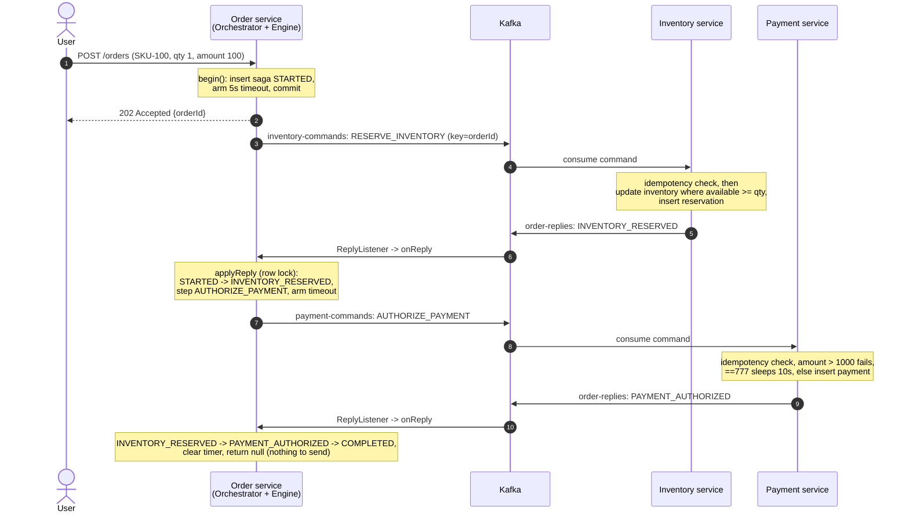
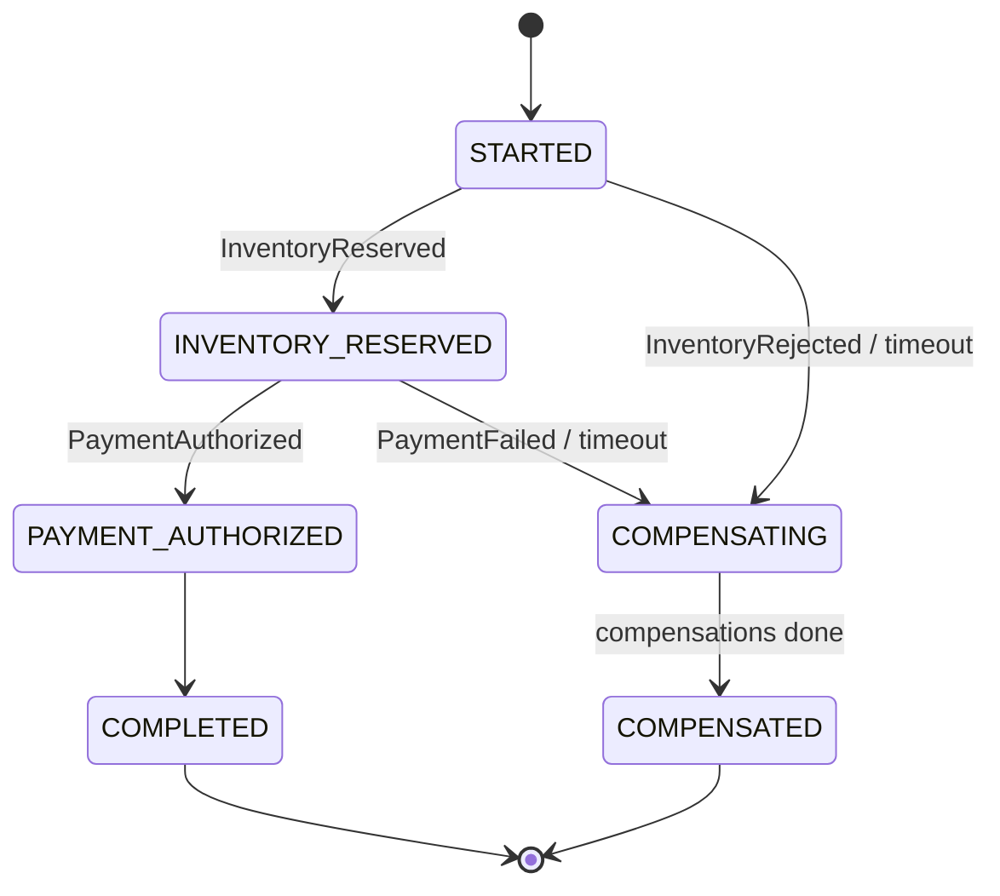

# Happy path flow (business view)

Order for SKU-100, qty 1, amount 100. Tracing left out; see `tracing-code-tutorial.md`.

## Sequence

Every Kafka send happens after the DB transaction commits.

## States (with unhappy paths)

## Key points

- `SagaEngine` is the state machine: each method is one `@Transactional` unit and returns the next `Command` (or `null`).
- `SagaOrchestrator` sends that command after commit. `send(null)` is a no-op (terminal state, ignored duplicate/late reply, or nothing due).
- Command id = `orderId:STEP`, same on every retry. Participants use it for idempotency (`processed_command`).
- Inventory check is atomic: `update ... where available >= qty`. 0 rows = `INVENTORY_REJECTED`.
- Payment simulation: `amount > 1000` -> `PAYMENT_FAILED`; `amount == 777` sleeps 10s (> 5s step timeout) -> timeout -> compensation; late `PAYMENT_AUTHORIZED` is ignored.
- Each step arms `nextActionAt`; `scanDue` fires timeouts/retries from it.
- Terminal states: `COMPLETED`, `COMPENSATED`. Compensation retries give up after `max-compensation-attempts` (manual action).
